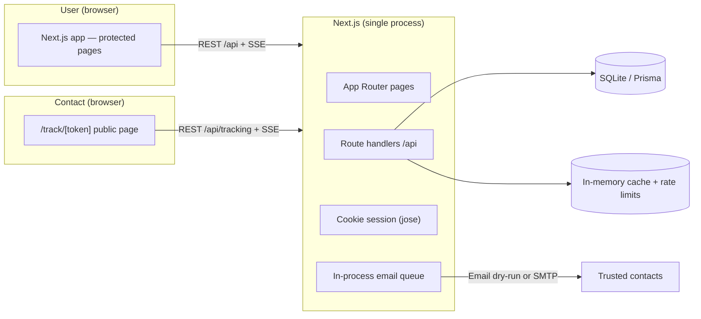

# bSafe — Silent SOS Emergency Web App

bSafe is a web-based silent emergency alert system: a user in danger triggers a silent SOS (single tap / long-press, zero sound or visible confirmation on-device), which shares their live location with pre-configured trusted contacts and tracks the alert until resolved.

> **Important:** bSafe is a **portfolio/demo build, not a production safety product.** It is not connected to any emergency services. Do not rely on it in a real emergency — call your local emergency number instead.

This repository is a **Next.js end-to-end re-implementation** of the original `bsafe` project (React + Vite frontend, NestJS API). The product behaviour is preserved; the infrastructure is simplified so the whole app runs as one process with `nodemon`.

---

## What is in this build

| What | Where |
| --- | --- |
| Web UI + API | `app/` — Next.js 16 App Router (pages + route handlers in one app) |
| Data layer | `prisma/` — Prisma 6 + SQLite |
| Shared types | `lib/types.ts` |
| Server services | `lib/server/` — auth, cache, rate limits, SSE, notifications, domain services |
| Client data layer | `lib/client/` — TanStack Query hooks + axios client |
| Docs | `docs/API_CONTRACT.md`, `docs/UI_SPEC.md`, `docs/PRD.md` |
| Demo & viva | `docs/DEMO_GUIDE.md`, `docs/VIVA_GUIDE.md` |

### Deliberate differences from the original

| Original | This build | Why |
| --- | --- | --- |
| Firebase Auth (email + Google) | Local email/password auth with a signed HttpOnly cookie | Runs without external credentials |
| PostgreSQL + Redis + BullMQ | SQLite + in-memory cache/rate-limit/queue | Zero-config local demo |
| Socket.IO gateway | Server-Sent Events (SSE) + REST location pings | Next.js route handlers have no WebSocket endpoint |
| Twilio SMS + email | **Email only** (Nodemailer, dry-run by default) | SMS intentionally out of scope |
| Vite dev server + Nest CLI | `nodemon` → `next dev` | Single dev runner, as requested |

Everything else (silent trigger, 5-contact cap, live location history, acknowledgement, tokenized tracking page, activity log, admin dashboard, per-route rate limits) is preserved.

---

## Tech stack

| Layer | Tech |
| --- | --- |
| Frontend | Next.js 16 (App Router), React 19, TypeScript, Tailwind CSS v4, TanStack Query, Leaflet |
| Backend | Next.js route handlers, Zod, bcryptjs, jose (JWT cookie) |
| Database | SQLite via Prisma 6 |
| Realtime | SSE (`/api/alerts/:id/stream`, `/api/tracking/:token/stream`) |
| Notifications | Nodemailer / console dry-run (no SMS) |
| Rate limit / cache | In-process fixed-window limiter + TTL cache |

---

## Architecture



### SOS data flow

1. The user taps or long-presses the silent dial on `/`.
2. `POST /api/alerts/trigger` creates an `Alert` (status `sent`) and one `NotificationDelivery` per contact.
3. The browser starts a 12-second location loop and persists each fix with `POST /api/alerts/:id/location`; updates are broadcast to the owner and tracking SSE channels.
4. Contacts open the emailed `/track/<token>` link and see the live map, status and timestamps.
5. Contacts can acknowledge; the user (or a contact) can resolve the alert. Every transition is written to `activity_logs`.
6. A resolved alert stops accepting locations and the public link shows the final state.

---

## Setup

Prerequisites: **Node.js ≥ 20.19**, npm.

```bash
# 1. Install dependencies
npm install

# 2. Environment (already committed as .env.example)
#    Windows PowerShell:
Copy-Item .env.example .env
#    macOS/Linux:
#    cp .env.example .env

# 3. Create the SQLite DB, generate the Prisma client, seed demo data
npm run setup

# 4. Run the app (nodemon → next dev on http://localhost:3000)
npm run dev
```

Open <http://localhost:3000>. `GET /api/health` should return
`{"status":"ok","database":"connected","auth":"cookie"}`.

### Demo accounts

All seeded accounts use password `Password123!`.

| Email | Role |
| --- | --- |
| `admin@bsafe.test` | Admin |
| `priya@example.com` | User with 5 contacts + alert history |
| `arjun@example.com` | User with 1 contact + a fresh active alert |

> The seed data in the original project used Firebase UIDs; this build seeds local
> password accounts instead so you can sign in immediately.

---

## Scripts

| Command | What it does |
| --- | --- |
| `npm run dev` | Start `next dev` on :3000 through **nodemon** |
| `npm run build` | Production build |
| `npm run start` | Start the production server |
| `npm run lint` | ESLint |
| `npm run typecheck` | `tsc --noEmit` |
| `npm run db:push` | Sync the Prisma schema to SQLite |
| `npm run db:seed` | Seed demo data |
| `npm run db:reset` | Force-reset the SQLite DB and re-seed |
| `npm run db:studio` | Prisma Studio |
| `npm run setup` | generate + push + seed |

`nodemon.json` watches the schema and config files and restarts `next dev` when they change;
all application code uses Next's own HMR.

---

## Environment variables

| Variable | Default / required | Notes |
| --- | --- | --- |
| `DATABASE_URL` | `file:./dev.db` | SQLite file under `prisma/` |
| `JWT_SECRET` | dev value | Change for anything shared; signs the session cookie |
| `ADMIN_EMAILS` | `admin@bsafe.test` | Comma-separated emails promoted to admin |
| `WEB_BASE_URL` | *(empty — auto-detect)* | Base for `/track/<token>` email links. Empty uses the request host, falling back to the machine's LAN IP when opened via localhost. Set it to a tunnel/domain when the app is shared. |
| `EMAIL_DRY_RUN` | `true` | Logs emails and marks deliveries `sent` |
| `SMTP_HOST/PORT/USER/PASS/FROM_EMAIL/FROM_NAME/SECURE` | – | Used only when `EMAIL_DRY_RUN=false` |

Never commit `.env` files — `.gitignore` excludes them.

---

## Routes

### Pages

| Route | Access | Description |
| --- | --- | --- |
| `/login` | public | Sign in / create account |
| `/` | protected | Silent SOS trigger + live status |
| `/contacts` | protected | Emergency contacts (max 5) |
| `/me` | protected | Profile |
| `/admin` | admin | Alert overview, KPIs, delivery retry |
| `/track/[token]` | public token | Contact tracking page (map, status, acknowledge) |

### API

All routes are under `/api` and individually rate-limited. Full request/response contract:
[`docs/API_CONTRACT.md`](docs/API_CONTRACT.md).

| Area | Routes |
| --- | --- |
| Auth | `POST /auth/signup`, `POST /auth/signin`, `POST /auth/signout`, `GET /auth/me`, `POST /auth/sync` |
| Users | `GET/PATCH /users/me` |
| Contacts | `GET/POST /contacts`, `PATCH/DELETE /contacts/:id` |
| Alerts | `POST /alerts/trigger`, `GET /alerts`, `GET /alerts/:id`, `POST /alerts/:id/location`, `PATCH /alerts/:id/status`, `GET /alerts/:id/stream` |
| Tracking | `GET /tracking/:token`, `POST /tracking/:token/acknowledge`, `GET /tracking/:token/stream` |
| Notifications | `GET /notifications/:alertId/status`, `POST /notifications/:alertId/retry` (admin) |
| Admin | `GET /admin/alerts`, `GET /admin/reports` |
| Health | `GET /health` |

---

## Manual test walkthrough

1. Sign in as `priya@example.com` / `Password123!`.
2. Confirm `/contacts` shows 5 contacts; edit/add/remove one and watch the counter update.
3. On `/`, enable location (or ignore it to test the last-known-location path).
4. Tap the dial once (or hold for 600ms). Nothing should pop up; the dial dims and `SOS ACTIVE` appears.
5. Open `/admin` as `admin@bsafe.test` and watch the alert/locations/delivery counts update.
6. Copy the tracking token from Prisma Studio (`npm run db:studio` → `alerts.tracking_token`) and open `/track/<token>` in a private window. The map should follow new fixes and the acknowledge button should move the alert to `acknowledged`.
7. Resolve the alert from `/`; the tracking page should show the resolved state and stop updating.
8. With `EMAIL_DRY_RUN=true`, the server console logs the tracking link email for each contact.

---

## Notes & limitations

- Single-process demo: rate-limit counters, cache and SSE event channels live in memory. They reset on restart and do not scale horizontally.
- Email is the only notification channel and is required on every contact.
- The browser Geolocation API requires HTTPS or `localhost`; background tabs may throttle `watchPosition`.
- No automated test suite (matching the original project's scope); verification is manual.
- The original project's production deployment notes do not apply; this build targets a local single-process demo.
