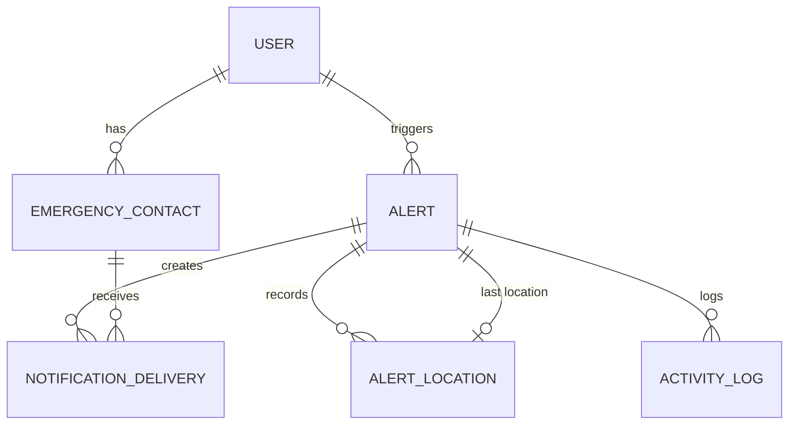

# bSafe — Viva / Oral Exam Guide

A question-and-answer guide for explaining the implementation, the database design, and the trade-offs. Answers are written the way you can say them out loud.

> **Important framing:** the original project had two servers (Vite frontend + NestJS API). This re-build is **one Next.js server** with two logical layers: pages/UI and `/api` route handlers. Say that early — it explains most of the architecture questions.

---

## 0. The 60-second summary

> bSafe is a silent SOS emergency web app. A user adds up to five trusted contacts, enables location during onboarding, and triggers a silent SOS with a tap or 600ms long-press. The backend creates an alert, stores the first location, appends every later GPS fix to `alert_locations`, and creates a tokenized public tracking link. Contacts open `/track/<token>` without logging in, see a live Leaflet map, and can acknowledge the alert. The user resolves it; the link stops updating. Admins get a read-only dashboard with cross-user alerts, delivery status, retries and KPIs. The stack is Next.js 16 App Router, React 19, Tailwind v4, Prisma 6 and SQLite. Authentication is a signed HttpOnly cookie; realtime is SSE; notifications are email-only by design.

---

## 1. Architecture

### Q1. Why Next.js instead of the original Vite + NestJS split?

**A:** The requirement was a Next.js end-to-end re-implementation. Next.js route handlers let one process serve both the UI and the API, which simplifies local setup and deployment. The logical separation is preserved: pages/components are the frontend layer; `app/api/` and `lib/server/` are the backend layer. The trade-off is that long-running/background work is less natural than in a dedicated NestJS process.

### Q2. Draw the architecture.

```text
Browser (user)                         Browser (contact)
  │  pages + TanStack Query              │  /track/<token>
  │  EventSource (SSE)                  │  EventSource (SSE)
  ▼                                     ▼
┌──────────────────────────────────────────────────────┐
│ Next.js 16 (one Node process)                        │
│  app/(app)/*, app/login, app/track   → UI            │
│  app/api/**                          → REST API      │
│  proxy.ts                            → page auth     │
│  lib/server/*                        → domain        │
│  in-memory cache / rate limit / SSE / email queue    │
└───────────────────────┬──────────────────────────────┘
                        │ Prisma 6
                        ▼
                  SQLite (dev.db)
```

### Q3. What happens on a page request vs an API request?

**A:**

- **Page request:** `proxy.ts` reads the session cookie and verifies the JWT. `/login` and `/track/*` are public. Other pages require a valid session; `/admin` additionally needs `isAdmin` in the token. The page/layout renders; client components hydrate and fetch API data.
- **API request:** the route handler calls `getAuthUser()` (verify JWT + load the current user from Prisma), applies the route's rate limit, validates with Zod, calls a service in `lib/server/`, accesses the database through Prisma, and returns JSON. Errors use `{ message }`.

### Q4. Why use `proxy.ts` instead of `middleware.ts`?

**A:** Next.js 16 renamed/deprecated the middleware convention to `proxy`. `proxy.ts` exports a `proxy` function and the same `config.matcher`; it runs before page routes. API routes are excluded from the matcher and each handler authenticates itself.

### Q5. Is the proxy the only authorization layer?

**A:** No. The proxy is a fast page-level gate based on JWT claims. Every API handler re-checks the session against the database, and admin APIs re-check `user.isAdmin`. That means hiding the admin link in the UI is never the only protection.

---

## 2. Authentication & security

### Q6. Explain login end-to-end.

**A:**

1. `POST /api/auth/signin` validates `{email,password}` with Zod.
2. The user row is loaded by email.
3. `bcrypt.compare` checks the password against `password_hash`.
4. `isListedAdmin(email)` checks `ADMIN_EMAILS` and may promote the user.
5. `createSessionToken()` signs an HS256 JWT with `sub`, `email`, `name`, `isAdmin`, 7-day expiry.
6. The token is set as `bsafe_session` — HttpOnly, SameSite=Lax, `secure` in production, path `/`.
7. The browser never sees the token in JavaScript; TanStack Query then calls `/api/auth/me`.

### Q7. Why an HttpOnly cookie instead of `localStorage`?

**A:** `localStorage` is readable by any JavaScript on the origin, so an XSS bug can steal the token. HttpOnly cookies are not readable from JS. SameSite=Lax reduces cross-site request risk. The trade-off is that you must think about CSRF; a production build should add an Origin check or a CSRF token.

### Q8. Why JWT if the user is also loaded from the DB on every request?

**A:** The JWT is a cheap, stateless proof of session identity for the proxy and for rejecting forged cookies. The DB lookup is the source of truth for current role/profile and still happens in API handlers. We are not relying on stale token claims for authorization.

### Q9. How are passwords stored?

**A:** `bcryptjs` with cost factor 10. The database stores only `password_hash`; plaintext passwords never touch the database or logs. Minimum length is 6 in this demo; a real product should require more and add breach checks.

### Q10. How does admin authorization work?

**A:** Three layers:

1. `ADMIN_EMAILS` grants/promotes `isAdmin` on signup/signin.
2. `proxy.ts` redirects non-admin page requests away from `/admin`.
3. `app/api/admin/*` and notification retry return `403` unless the DB user has `isAdmin`.

### Q11. What input validation exists?

**A:** Zod schemas in `lib/server/validation.ts` validate names, emails, E.164 phones, password length, coordinates, status transitions, UUIDs and query pagination. Prisma also enforces unique constraints. Zod failures return `400` with a `message` array.

### Q12. How do you prevent SQL injection?

**A:** We do not concatenate SQL. Prisma uses parameterized queries and a typed schema. The only raw query is `SELECT 1` in the health check. Admin reports use Prisma queries and JavaScript aggregation rather than string-built SQL.

### Q13. How does the public tracking link stay private?

**A:** The token is a UUID (`Alert.trackingToken`, unique). The public DTO exposes only `userName`, status, timestamps, last location and location count — no alert id, user id, phone, email or contact list. The token is unguessable, but it does **not** time-expire in this build; it stops updating when the alert resolves. Production would add a TTL and revocation.

### Q14. What about XSS in emails?

**A:** The user's name is escaped with `escapeHtml()` before being inserted into the email HTML. React escapes rendered page text by default. A production build should also set a Content-Security-Policy.

---

## 3. The alert lifecycle

### Q15. Explain the SOS trigger flow.

**A:** `POST /api/alerts/trigger`:

1. Authenticate + rate limit (5/min).
2. Validate optional `{triggerType, latitude, longitude, accuracy}`.
3. Create `alerts` row with status `sent` and a UUID tracking token.
4. Insert `activity_logs` event `triggered`.
5. If a fix was supplied, insert `alert_locations` and set `alerts.last_location_id`.
6. Create one `notification_deliveries` row per contact that has an email.
7. Dispatch emails asynchronously (in-process queue).
8. Return `201` with `AlertDto`.

### Q16. What are the alert states and allowed transitions?

**A:** `sent → acknowledged → resolved`, and `sent → resolved` directly. Rules:

- `acknowledged` only from `sent`.
- `resolved` from `sent` or `acknowledged`.
- Once `resolved`, no further status changes and no new locations (`409`).
- The public tracking acknowledge endpoint only works from `sent`.

### Q17. How is live location stored?

**A:** Every fix is a new `alert_locations` row (time-series history). `alerts.last_location_id` points at the most recent row for fast reads. `alerts` does not overwrite the history.

### Q18. Why is `last_location_id` there? Isn't that denormalization?

**A:** Yes, it is controlled denormalization. It turns “get the latest location” into a single indexed lookup instead of `ORDER BY recorded_at DESC LIMIT 1` over a growing history. The `alert_locations` table remains the source of truth, and `last_location_id` is updated in the same write path. The trade-off is that the pointer must stay consistent.

### Q19. What happens if GPS is denied or the tab is backgrounded?

**A:** If permission is denied, the alert still triggers with the last-known position (possibly none). If GPS is temporarily unavailable, the hook keeps the last-known position. When the tab becomes hidden, the client sends one last fix; browsers may throttle `watchPosition` in the background. The tracking page always shows the last update timestamp so contacts can judge freshness.

### Q20. How do contacts see updates quickly?

**A:** SSE streams (`/api/alerts/:id/stream` for the owner, `/api/tracking/:token/stream` for contacts) emit an `update` signal whenever a location or status changes. Clients invalidate/refetch their TanStack Query. Polling remains as a fallback: 15s owner, 12s tracking.

---

## 4. Database & DBMS

### Q21. Draw the ER model.



### Q22. List the tables and their purpose.

| Table | Purpose |
| --- | --- |
| `users` | Account, hashed password, optional phone, admin flag |
| `emergency_contacts` | Up to 5 trusted contacts per user |
| `alerts` | One row per SOS; status, timestamps, tracking token, last location pointer |
| `alert_locations` | Time-series of GPS fixes |
| `activity_logs` | Append-only audit trail of transitions |
| `notification_deliveries` | Per-contact, per-channel delivery status |

### Q23. What are the keys and constraints?

- **Primary keys:** UUID strings on every table.
- **Foreign keys:** contacts/alerts → users; locations/logs/deliveries → alerts; deliveries → contacts; alerts.last_location_id → alert_locations.
- **Unique:** `users.email`, `users.phone`, `alerts.tracking_token`, `alerts.last_location_id`, `emergency_contacts(user_id, phone)`, `emergency_contacts(user_id, email)`, `notification_deliveries(alert_id, contact_id, channel)`.
- **Cascade:** deleting a user cascades contacts and alerts; deleting an alert cascades locations, logs and deliveries.
- **Indexes:** contacts by user; alerts by user/status; locations by `(alert_id, recorded_at)`; logs by alert; deliveries by alert/status.

### Q24. Which normal form is the schema in?

**A:** The core tables are in 3NF: each non-key field depends on the key, the whole key, and nothing but the key. `last_location_id` is an intentional denormalization for read performance, and `locationCount` / delivery counts are computed at query time rather than stored, avoiding update anomalies.

### Q25. Why SQLite? How would you switch to PostgreSQL?

**A:** SQLite gives a zero-config demo database. Prisma isolates most of the code, so moving to Postgres is mainly: change the datasource provider, use Postgres-specific types/enums, regenerate migrations, and set `DATABASE_URL`. The admin report code would also move from JS aggregation to SQL aggregates (`date_trunc`, `interval`). SQLite has no native enums, so status/channel are strings validated by Zod and the service layer.

### Q26. Explain ACID in this project. Are writes transactional?

**A:** SQLite and Prisma are ACID-capable, but the trigger flow currently performs several separate writes (alert, activity log, location, delivery rows) without wrapping them in `prisma.$transaction`. So a crash between steps could leave a partially created alert. This is an honest limitation. The fix is an interactive transaction:

```ts
await prisma.$transaction(async (tx) => {
  const alert = await tx.alert.create({ data: { userId } });
  await tx.activityLog.create({ data: { alertId: alert.id, eventType: "triggered" } });
  // location + deliveries...
});
```

### Q27. What race conditions exist?

**A:**

- **Duplicate contact:** the service pre-checks, but two concurrent requests could both pass; the DB unique constraint is the backstop and the create catches `P2002` → `409`.
- **6th contact:** count-then-create can race; a strict production design would lock or use a serializable transaction.
- **Double trigger:** the UI latches for 350ms and the route allows 5/min; a malicious client can still create multiple alerts. An idempotency key would fix that.
- **last_location_id:** two concurrent location writes could race on the pointer; the latest write wins. The history rows remain correct.

### Q28. Why is `(alert_id, recorded_at)` indexed?

**A:** The dominant query is “locations for this alert ordered by time.” A composite index supports both the equality filter on `alert_id` and the time ordering/range, avoiding a full scan as history grows.

### Q29. Write a query to list active alerts with user names.

```sql
SELECT a.id, u.name, a.status, a.triggered_at
FROM alerts a
JOIN users u ON u.id = a.user_id
WHERE a.status IN ('sent', 'acknowledged')
ORDER BY a.triggered_at DESC;
```

### Q30. How is average acknowledgement time calculated?

**A:** For each `activity_logs` row with `event_type = 'acknowledged'`, find its alert and compute `(log.timestamp - alert.triggered_at) / 60000` minutes; average those values. The app does this in JavaScript because SQLite lacks Postgres' interval functions. Average resolve time uses `resolved_at - triggered_at`.

### Q31. What is `ackRate`?

**A:** `acknowledged` means the alert reached `acknowledged` or `resolved`; `ackRate = acknowledged / total alerts`. It measures whether contacts engaged, not whether they resolved it.

### Q32. How would you handle data growth?

**A:** Indexes already cover the common reads. For production: partition/archive old `alert_locations`, add retention policies, paginate admin queries (already supports `take`/`skip`), and move admin aggregations to SQL/rollups. SQLite is not the right engine for high write concurrency.

---

## 5. Realtime: SSE vs WebSocket

### Q33. Why SSE instead of the original Socket.IO gateway?

**A:** Next.js route handlers do not expose a WebSocket endpoint without a custom server. SSE is a one-way server→client stream over plain HTTP and fits the need: clients only need a signal that data changed. Location writes go **upstream over REST**. SSE also reconnects automatically in the browser.

### Q34. How is SSE implemented?

**A:** `lib/server/sse.ts` returns a `ReadableStream` with `Content-Type: text/event-stream`. It sends a `hello` event, subscribes to an in-memory channel, sends `update` events (`{reason, at}`), and writes a keep-alive comment every 15s. On abort/cancel it unsubscribes and clears the heartbeat.

### Q35. What are the scaling limits of SSE here?

**A:** Channels live in a `Map` in one Node process. Multiple instances would need Redis pub/sub (or another broker) so an event on instance A reaches a subscriber on instance B. SSE also consumes one open HTTP connection per client; that is acceptable for a demo but needs capacity planning in production.

### Q36. Why doesn't the SSE event contain the full alert object?

**A:** Keeping the event as a small “refetch” signal avoids duplicating DTO logic and prevents accidentally leaking owner fields into the public tracking stream. The REST endpoint remains the single source of truth.

---

## 6. Notifications

### Q37. Explain the email delivery flow.

**A:** On trigger, one `notification_deliveries` row is created per contact, status `queued`. A background function processes each delivery: increment `attempts`, call `sendEmail`, mark `sent` + `sentAt`, or retry up to 3 times with 0/250/1000ms backoff. After the final failure it marks `failed` and stores `last_error`. Admins can requeue failed deliveries.

### Q38. Why "sent" is not "delivered"?

**A:** `sent` means the app handed the message to Nodemailer/the provider. It does not prove inbox delivery. A production system would add provider webhooks for delivered/bounced/complained states.

### Q39. Why no SMS?

**A:** SMS was explicitly removed for this build. The schema keeps a `channel` field, currently only `email`, so adding SMS later would mean a Twilio provider plus a delivery row per channel — no structural redesign.

### Q40. What happens if the process crashes mid-queue?

**A:** In-memory queue work is lost. Rows already `queued` would need a startup recovery sweep to be re-dispatched. Production would use BullMQ/Redis or a database-backed outbox with a worker and retries. This is a key limitation to state honestly.

### Q41. What is the tracking URL in the email?

**A:** `${WEB_BASE_URL}/track/<trackingToken>`. It is generated from the alert's unguessable token, not from an internal alert id.

---

## 7. Rate limiting & caching

### Q42. How does rate limiting work?

**A:** `rateLimit(key, limit)` keeps a fixed-window counter in a `Map`: `{count, resetAt}`. Keys are per user for authenticated routes and per IP for public routes. Over-limit requests get `429` with `Retry-After`. It resets on restart and is per process — production would use Redis.

### Q43. Why is the SOS trigger limited to 5/min?

**A:** It is deliberately permissive enough for a genuine re-trigger but tight enough to blunt abuse. Public tracking is per-IP (20/min read, 10/min acknowledge) because it is unauthenticated. Location updates are 60/min, matching the 12s client interval with headroom.

### Q44. How does caching work?

**A:** Profile data is cached 60s, contacts 30s, in a TTL `Map`. Contact writes delete `contacts:<userId>`; profile writes delete `profile:<userId>`. This is read-through caching with explicit invalidation, not write-through.

### Q45. What is the cache consistency risk?

**A:** In a multi-instance deployment, deleting a key only clears the local instance. Other instances could serve stale data until TTL expires. Redis with pub/sub or versioned keys would solve it.

---

## 8. Frontend details

### Q46. Why TanStack Query?

**A:** It gives request caching, loading/error states, mutations, invalidation and polling with little boilerplate. The contacts page invalidates `['contacts']` after add/edit/delete; admin retry invalidates admin alerts. Shared query keys mean the sidebar contact count and the contacts page stay in sync.

### Q47. Server vs client components in this app?

**A:** Layouts and simple pages are server components. Screens that use hooks/state/browser APIs (`SosPanel`, contacts form, admin table, login, tracking map) are client components. The protected layout renders a client `AppShell`, which guards auth on the client while the proxy guards it on the server.

### Q48. Why does the map use `next/dynamic({ ssr: false })`?

**A:** Leaflet touches `window`/`document`; server rendering would crash. Dynamic import with `ssr:false` loads it only in the browser. The map updates the marker/accuracy circle in an effect and stops auto-following once the viewer pans or zooms.

### Q49. How is the SOS button "silent"?

**A:** `SosButton` fires on `click` or a 600ms hold, with a latch to prevent double firing. On success there is no sound, modal or success animation. The dial dims and shows `TRANSMITTING`/`SOS ACTIVE`. The only other feedback is a quiet location count and a resolve link.

### Q50. How is the active alert remembered?

**A:** `localStorage['bsafe.activeAlertId']`. On load, `SosPanel` reads it, fetches the alert, and resumes polling/SSE. A `404` clears the stale id. Resolving the alert clears it.

### Q51. What accessibility/responsiveness choices were made?

**A:** Semantic landmarks/nav, labels tied to inputs, `aria-label` on the SOS dial, `role="img"` + label on the map/chart, visible focus rings, reduced-motion handling, and a mobile bottom navigation that replaces the desktop rail.

---

## 9. Trade-offs, limitations & improvements

### Q52. What are the main limitations?

- Single process: in-memory cache, rate limits, queue and SSE channels.
- SQLite: demo-scale concurrency; no native enums; not production-grade for this write pattern.
- No SMS/Firebase/Redis/BullMQ, by instruction.
- No automated test suite; manual verification only.
- Trigger flow is not transactional.
- Public tracking link has no time-based expiry.
- Email dry-run by default; "sent" is not "delivered".
- No refresh-token rotation or CSRF token.

### Q53. What would you improve first for production?

**A:** In order:

1. Move to PostgreSQL + migrations, and wrap trigger/location writes in transactions.
2. Redis for rate limits/cache and BullMQ/outbox for notifications.
3. Redis pub/sub for SSE across instances.
4. SMTP/provider webhooks + delivery/bounce states.
5. Time-expiring, revocable tracking tokens.
6. CSRF/Origin checks, CSP, stronger password policy, audit of admin actions.
7. Automated unit/integration/e2e tests (Vitest + Playwright).
8. Idempotency keys for the trigger endpoint.

### Q54. How would you deploy this?

**A:** `npm run build` then `npm start` behind a reverse proxy with a persistent volume for SQLite if staying on SQLite. Environment variables: `DATABASE_URL`, `JWT_SECRET`, `ADMIN_EMAILS`, `WEB_BASE_URL`, SMTP settings. For a serverless host, SQLite's local file is not durable — use Postgres and an external queue.

### Q55. How would you test the critical path?

**A:** API integration tests for auth, contact cap/duplicates, trigger idempotency, status transitions, tracking privacy and rate limits; SSE contract tests; and a Playwright flow: login → add contact → trigger → open tracking link → acknowledge → resolve. Currently verification is manual.

---

## 10. Rapid-fire questions

| Question | Short answer |
| --- | --- |
| What is the primary key type? | UUID string, generated by Prisma |
| Why UUID for tokens? | Unguessable, non-sequential, safe in a public URL |
| What happens on deleting a user? | Cascade deletes contacts and alerts, then locations/logs/deliveries |
| Which table stores GPS history? | `alert_locations` |
| Which table is the audit trail? | `activity_logs` |
| What status does a new alert have? | `sent` |
| Can a resolved alert get a new location? | No, `409` |
| Can a contact resolve? | No, only acknowledge in this build |
| Which endpoint is public? | `/api/tracking/:token` and `/track/[token]` |
| How is the contact cap enforced? | Service count check + 400 |
| How are duplicate contacts prevented? | Pre-check + unique constraints + P2002 → 409 |
| How is the session stored? | HttpOnly `bsafe_session` cookie |
| JWT algorithm/expiry? | HS256, 7 days |
| Password hash? | bcryptjs, cost 10 |
| Admin source of truth? | `users.is_admin`, with `ADMIN_EMAILS` promotion |
| Realtime transport? | SSE + REST location posts |
| SSE heartbeat? | 15 seconds |
| Owner poll / tracking poll? | 15s / 12s |
| Location post interval? | 12 seconds |
| Notification retries? | 3, with 0/250/1000ms backoff |
| Notification channel? | Email only; SMS intentionally absent |
| Cache TTLs? | 60s profile, 30s contacts |
| Rate-limit algorithm? | In-memory fixed window |
| SQLite enums? | None; strings validated by Zod |
| What does `proxy.ts` protect? | Pages; API handlers authenticate themselves |
| Why `runtime = "nodejs"`? | Prisma/bcrypt/nodemailer need Node APIs |
| Why `dynamic = "force-dynamic"`? | Per-request auth/data, no static caching |
| Why `serverExternalPackages`? | Keep Prisma/bcrypt/nodemailer out of the bundler |
| Is `last_location_id` normalized? | No, intentional read optimization |
| Is the trigger transactional? | Not yet — known limitation |
| Test suite? | None; manual checks, as scoped |

---

## 11. Code snippets to be ready to explain

### JWT session

```ts
new SignJWT({ email, name, isAdmin })
  .setProtectedHeader({ alg: "HS256" })
  .setSubject(user.id)
  .setIssuedAt()
  .setExpirationTime("604800s")
  .sign(secret);
```

### Auth lookup

```ts
const claims = await verifySessionToken(request.cookies.get("bsafe_session")?.value);
const user = await prisma.user.findUnique({ where: { id: claims.sub } });
```

### Fixed-window rate limit

```ts
bucket.count += 1;
if (bucket.count > limit) return { ok: false, retryAfter };
```

### Trigger service

```ts
const alert = await prisma.alert.create({ data: { userId } });
await prisma.activityLog.create({ data: { alertId: alert.id, eventType: "triggered" } });
// first location, delivery rows, async email dispatch
```

### Status transition

```ts
if (alert.status === "resolved") throw new ApiError(400, "Alert is already resolved.");
if (status === "acknowledged" && alert.status !== "sent") {
  throw new ApiError(400, "Only a sent alert can be acknowledged.");
}
```

### SSE helper

```ts
return new Response(stream, {
  headers: { "Content-Type": "text/event-stream", "Cache-Control": "no-cache" },
});
```

### Prisma schema excerpt

```prisma
model Alert {
  id             String    @id @default(uuid())
  userId         String    @map("user_id")
  status         String    @default("sent")
  trackingToken  String    @unique @map("tracking_token") @default(uuid())
  triggeredAt    DateTime  @default(now()) @map("triggered_at")
  resolvedAt     DateTime? @map("resolved_at")
  lastLocationId String?   @unique @map("last_location_id")
  // relations...
}
```

---

## 12. Whiteboard answer (if asked to draw the flow)

```text
SOS tap
  │
  ▼
POST /api/alerts/trigger ──► auth ──► rate limit ──► Zod
  │
  ├─ alerts(status=sent, token)
  ├─ activity_logs(triggered)
  ├─ alert_locations(first fix) ──► alerts.last_location_id
  └─ notification_deliveries(email) ──► async send
                                             │
                                             ▼
                                   email/tracking link
                                             │
Contact opens /track/<token> ──► GET /api/tracking/:token
  │
  ├─ acknowledge ──► status=acknowledged + log + SSE
  │
User resolves ──► status=resolved + resolved_at + log + SSE
  │
  └─ tracking page shows final state; location POSTs rejected
```

---

## 13. Seeded demo data (useful in viva)

| Entity | Count |
| --- | --- |
| Users | 3 (`priya`, `arjun`, `admin`) |
| Emergency contacts | 7 |
| Alerts | 3 (resolved, acknowledged, sent) |
| Locations | 10 |
| Activity logs | 6 |
| Notification deliveries | 10 (including one deliberately failed) |

All seeded accounts use the password `Password123!`.

---

## 14. If the examiner asks "where is the backend?"

Open this file order:

1. `app/api/alerts/trigger/route.ts` — HTTP entry point.
2. `lib/server/alerts.ts` — business logic.
3. `lib/server/notifications.ts` — delivery orchestration.
4. `prisma/schema.prisma` — data model.
5. `lib/server/auth.ts` + `proxy.ts` — authentication/authorization.
6. `lib/server/tracking.ts` — public view and acknowledgement.
7. `lib/server/admin.ts` — reporting.

And for the frontend:

1. `app/(app)/layout.tsx` + `components/AppShell.tsx` — protected shell.
2. `components/SosPanel.tsx` — silent trigger + streaming.
3. `app/track/[token]/page.tsx` — public tracking UI.
4. `app/(app)/admin/page.tsx` — dashboard.
5. `lib/client/*.ts` — TanStack Query hooks.
